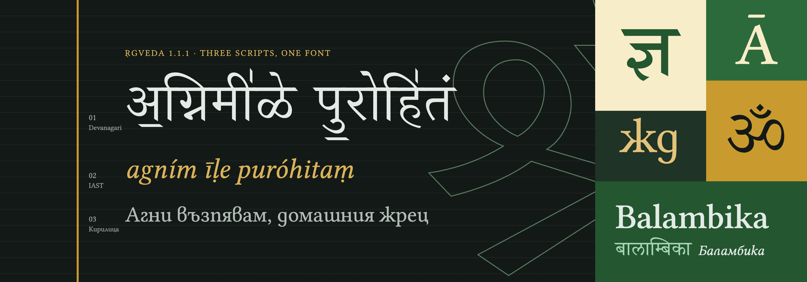

# Balambika



Balambika (*Bālāmbikā*) is a font family for Sanskrit publishing — Vedic and
Purāṇic texts set in Devanagari, with IAST transliteration and Bulgarian or
English translation, in one font that works the same in Pages, Word and
XeLaTeX. It comes in two families: **Balambika** (serif) and
**Balambika Sans**.

Specimens, a conjunct explorer and a type tester are on the website:
<https://nelvaron.github.io/balambika/>.

Each family is a compilation of two typefaces released under the SIL Open
Font License:

| Family | Component | Source | Scripts |
|---|---|---|---|
| Balambika | Devanagari | [Shobhika](https://github.com/Sandhi-IITBombay/Shobhika) 1.05, IIT Bombay (Devanagari based on Yashomudra) | Devanagari, Vedic Extensions, part of Devanagari Extended, PUA alternates |
| Balambika | Latin, IAST, Cyrillic | [Common Serif](https://github.com/StefanPeev/Common-Serif) 1.048, The Common Serif Project Authors (derived from Libertinus Serif) | Latin incl. full IAST, Bulgarian Cyrillic, Greek |
| Balambika Sans | Devanagari | [Noto Sans Devanagari](https://github.com/notofonts/devanagari) 2.007, The Noto Project Authors | Devanagari, Vedic Extensions, Devanagari Extended incl. Sāmaveda notation |
| Balambika Sans | Latin, IAST, Cyrillic | [Source Sans 3](https://github.com/adobe-fonts/source-sans) 3.052, Adobe | Latin incl. full IAST, Bulgarian Cyrillic, Greek |

## Styles

### Balambika

| File | Style | Latin / Cyrillic from | Devanagari from | Weight |
|---|---|---|---|---|
| `Balambika-Regular.ttf` | Regular | Common Serif Regular | Shobhika Regular | 400 |
| `Balambika-Italic.ttf` | Italic | Common Serif Italic | Shobhika Regular (upright) | 400 |
| `Balambika-Medium.ttf` | Medium | Common Serif Medium | Shobhika Bold | 500 |
| `Balambika-MediumItalic.ttf` | Medium Italic | Common Serif Medium Italic | Shobhika Bold (upright) | 500 |
| `Balambika-Bold.ttf` | Bold | Common Serif **SemiBold** | Shobhika Bold | 700 |
| `Balambika-BoldItalic.ttf` | Bold Italic | Common Serif **SemiBold** Italic | Shobhika Bold (upright) | 700 |

### Balambika Sans

Six weights, each with an italic: `BalambikaSans-<Style>.ttf`.

| Style | Weight | Source Sans 3 | Noto Sans Devanagari |
|---|---|---|---|
| Light, Light Italic | 300 | wght 300 | wght 245 |
| Regular, Italic | 400 | wght 400 | wght 405 |
| Medium, Medium Italic | 500 | wght 500 | wght 505 |
| SemiBold, SemiBold Italic | 600 | wght 600 | wght 590 |
| Bold, Bold Italic | 700 | wght 700 | wght 745 |
| Black, Black Italic | 900 | wght 900 | wght 875 |

In both families, Regular, Italic, Bold and Bold Italic form the style-linked
(RIBBI) family, so the B and I buttons in Word and Pages work as expected.
The other weights appear as separate families (*Balambika Medium*,
*Balambika Sans Light*, …) in applications that do not read typographic
family names.

## Design decisions

### Both families

- **Upright Devanagari in italic styles.** Devanagari has no italic tradition;
  the italic files contain the same upright Devanagari, so applications never
  synthesise a slanted one.
- **Bulgarian Cyrillic is the default.** The Bulgarian forms are mapped
  directly in `cmap`, so they appear without language tagging, which Word and
  Pages do not apply reliably. The forms are taken from what HarfBuzz renders
  with `language=bg`, so every Bulgarian `locl` lookup of the source counts.
  The Russian, Serbian and Macedonian alternates are removed.
- **Devanagari word spacing.** Latin and Cyrillic use the Latin source's
  space. Between two Devanagari words a contextual `calt` lookup (deva/dev2
  only) substitutes `space.deva`, which keeps the Devanagari source's own
  width. A space next to Latin or Cyrillic keeps the Latin width, so a
  Devanagari word inside English or Bulgarian text is spaced evenly on both
  sides. (`calt` rather than `locl`: shapers apply `locl` to Indic text per
  syllable, so its context cannot see neighbouring words.)
- **Vertical metrics.** `hhea` = `typo` = 1000 / −400 / 0 (default line height
  1.4 em) with `USE_TYPO_METRICS` set. `usWinAscent/Descent` cover the full
  bounding box so stacked Vedic marks are never clipped.
- **TrueType outlines, autohinted** with ttfautohint (Latin default,
  Devanagari detected automatically), so both scripts share one hinting model.

### Balambika

- **Latin scaled to 108 %.** Common Serif's cap height (645) becomes 697,
  matching Shobhika's headline (700). x-height becomes 463.
- **Bold uses Common Serif SemiBold.** Measured stem widths (after scaling):
  Common Serif Regular 86, Medium 105, SemiBold 122, Bold 140; Shobhika
  Regular 80, Bold 108. Shobhika has only two weights and its masters are not
  interpolation-compatible, so Medium and Bold share Shobhika Bold, and
  SemiBold is the closest Latin partner for a balanced bold.
- **Spaces:** Latin 259 units, Devanagari 450 (Regular) and 500 (Medium,
  Bold). Win metrics 1121 / 1015.
- Common Serif and Shobhika are CFF fonts and are converted to TrueType.

### Balambika Sans

- **Latin scaled to 109 %.** Source Sans 3's cap height (660) becomes 719,
  matching Noto Sans (714), which is how the Noto project pairs its Latin with
  Noto Sans Devanagari. The Devanagari headline sits at 622, below the cap
  height, as in Noto. x-height becomes 530 (Regular).
- **Weights matched by stem.** Both sources are variable fonts. Each Latin
  weight is paired with the Noto Sans Devanagari instance whose vertical stem
  is about 92 % of the scaled Source Sans stem — the same balance as in the
  serif family, since the headline makes Devanagari look darker.
- **Overlaps removed** when the variable sources are instanced.
- **Spaces:** Latin 218 units, Devanagari 260. Win metrics 1347–1348 /
  523–556.

## Building

Requirements: Python 3.10+, and

```sh
pip install -r requirements.txt
```

Source fonts are in `sources/` (see `sources/README.md`). Then:

```sh
python3 build.py                  # both families -> fonts/ttf/
python3 build.py --family sans    # one family: serif or sans
python3 build.py --style Regular  # one style name, in every family
python3 build.py --no-autohint    # unhinted
python3 tools/verify.py           # compare shaping with the source fonts
```

Configuration is at the top of `build.py`: shared settings (vertical metrics,
Devanagari space, code-point split) and one `Family` entry per family (scale
factor, copyright, styles and their source files or variable instances). When
a source font is updated, replace the file in `sources/` and rebuild.

`tools/verify.py` shapes test strings with HarfBuzz and checks, for every
style, that Devanagari and Vedic text (and Sāmaveda notation where the source
covers it) produce the same glyphs and positions as the Devanagari source, and
Latin/IAST/Cyrillic the same as the Latin source with Bulgarian localisation,
positions scaled by the family's factor. It also checks word spacing, IAST and
Bulgarian coverage and the style naming.

## Using the fonts

### Pages (macOS)

- Use *Spacing › Exactly* for even line spacing in mixed-script text.
- Hyphenation follows the document language; switch it off per paragraph
  (*Format › Text › More*) for IAST-heavy passages, or protect terms with
  non-breaking spaces.

### Word

- Set Balambika (or Balambika Sans) as both the Latin and the *Complex
  scripts* font in every style, with the same size and bold settings,
  otherwise Devanagari words inside Latin text may come out in a different
  size or weight.
- Word for Windows uses `usWin` metrics for line height, so the default
  spacing is loose; use *Line spacing › Exactly*.
- Mark IAST as *Do not check spelling or grammar* (or as Sanskrit).

### XeLaTeX

XeTeX shapes each font instance with a single OpenType script. Devanagari
must therefore be set with a `Script=Devanagari` instance, even though
everything is in one file. See `examples/xelatex-specimen.tex` for a complete
polyglossia setup with both families:

```latex
\usepackage{fontspec}
\usepackage{polyglossia}
\setdefaultlanguage{bulgarian}
\setotherlanguages{english, sanskrit}

\setmainfont{Balambika}[
  UprightFont = *-Regular, ItalicFont = *-Italic,
  BoldFont = *-Bold, BoldItalicFont = *-BoldItalic,
  FontFace = {mb}{n}{*-Medium}, FontFace = {mb}{it}{*-MediumItalic}]
\newfontfamily\devanagarifont{Balambika}[Script = Devanagari,
  WordSpace = 1.737, BoldFeatures = {WordSpace = 1.931},
  UprightFont = *-Regular, BoldFont = *-Bold, ...]
\newfontfamily\iastfont{Balambika}[UprightFont = *-Regular, ...]

% Balambika Sans: Devanagari space 260 / Latin space 218 = 1.193
\setsansfont{BalambikaSans}[
  UprightFont = *-Regular, ItalicFont = *-Italic,
  BoldFont = *-Bold, BoldItalicFont = *-BoldItalic]
\newfontfamily\devanagarifontsf{BalambikaSans}[Script = Devanagari,
  WordSpace = 1.193, UprightFont = *-Regular, BoldFont = *-Bold, ...]

\newcommand\dev[1]{\textsanskrit{#1}}
\newcommand\iast[1]{\textlang{sa-Latn}{\iastfont\itshape #1}}
```

Notes:

- Define `\devanagarifont`, not `\sanskritfont`: polyglossia applies
  `\sanskritfont` even to `sa-Latn`, which would shape IAST with Devanagari
  features. Polyglossia uses `\devanagarifontsf` inside `\sffamily`.
- XeTeX measures the word space from a lone U+0020, so the font's contextual
  Devanagari space never applies; `WordSpace` restores the Devanagari
  spacing (Balambika: 450/259 = 1.737 for Regular, 500/259 = 1.931 for Medium
  and Bold; Balambika Sans: 260/218 = 1.193 for every weight).
- `\textsanskrit[script=latin]{…}` inserts spurious space in current
  polyglossia; use `\textlang{sa-Latn}{…}` instead.

## Known limitations

See also [ACCESSIBILITY.md](ACCESSIBILITY.md).

- **Devanagari Extended** (U+A8E0–U+A8FF) in **Balambika**: Shobhika covers
  only 6 of 32 characters. Missing: the Sāmaveda combining digits and letters
  U+A8E0–U+A8F1, U+A8F2 (spacing candrabindu), U+A8F8–U+A8FA,
  U+A8FC–U+A8FF. Balambika Sans covers the whole block.
- **Vedic Extensions**: U+1CF7 and U+1CFA are missing in both families.
- Common Serif has no `mkmk` feature. Precomposed IAST letters with an added
  accent (e.g. *ā́*) position correctly; long stacks of combining marks on one
  base letter may not.
- Hinting is automatic; at small screen sizes on Windows some Devanagari
  details may be less crisp than with hand-made hinting.

## License

SIL Open Font License 1.1 — see `OFL.txt`.

**Balambika** is a Reserved Font Name; it also covers *Balambika Sans*.
Modified versions made by anyone other than the copyright holder must be
distributed under a different name; this includes rebuilds, subsets and
format conversions (e.g. WOFF2) that are redistributed. No Reserved Font Name
of the source fonts ("Common Serif", "Linux Libertine", "Biolinum",
"STIX Fonts", "Source") is used as the font name. The original license and
copyright files of all sources are in `sources/` (see `sources/README.md`).

The OS/2 vendor ID is `NELV`, registered to Nelvaron in the
[Microsoft Typography vendor registry](https://learn.microsoft.com/en-us/typography/vendors/).
The fonts may be used, embedded and redistributed freely, including in
commercial books, but may not be sold on their own.
